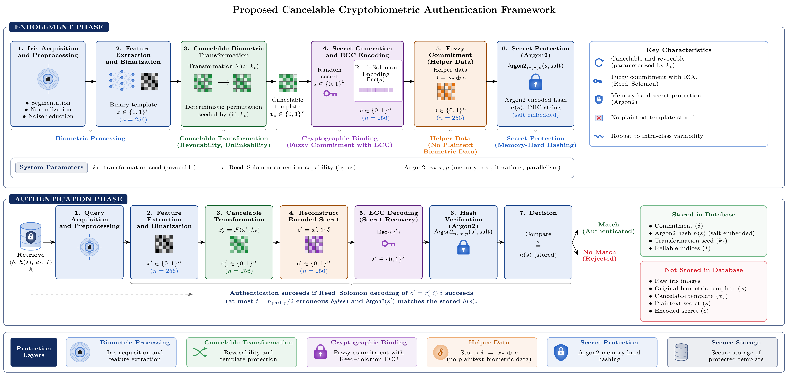

# Iris Cryptobiometric Authentication System

An iris-based cryptobiometric authentication system developed as a Master's thesis. A deep neural network extracts a compact feature vector from the user's iris. The vector is made **cancelable** and bound to a random secret through a **fuzzy commitment** scheme with **Reed-Solomon** error correction. Only an **Argon2** hash of that secret is stored, so no raw biometric data is kept.

## Demo

[https://github.com/user-attachments/assets/REPLACE-WITH-YOUR-VIDEO](https://github.com/user-attachments/assets/eb83983c-ed51-4db1-80b1-b896dc9ceccc)

## System overview

The system has two subsystems:

- **Biometric subsystem:** iris preprocessing and segmentation, rubber sheet normalisation to a 64×512 polar strip, and a 2048-d embedding from EfficientNetV2-S trained with ArcFace.
- **Cryptographic subsystem:** binarisation, per-user cancelable permutation, fuzzy commitment with Reed-Solomon, and Argon2id hashing of the secret.

## Results

| Metric | Value |
|---|---|
| EER (original domain) | 0.86 % |
| EER (cancelable domain) | 1.01 % |
| GAR (full cryptographic pipeline) | 85.09 % |
| FAR (full cryptographic pipeline) | 0.0030 % |
| Authentication time | ~8 ms |
| Storage per user | ~2.0 KB |

Evaluated on CASIA, PolyU, IITD and UBIRIS with subject-disjoint training and evaluation partitions. Non-invertibility, revocability and unlinkability are analysed following ISO/IEC 24745.

## Repository structure

| Script | Purpose |
|---|---|
| `01_explore_datasets.py` | Dataset exploration and statistics |
| `02_preprocess.py` | Grayscale conversion, resizing and CLAHE |
| `03_segment.py` | Iris segmentation (U-Net++) |
| `04_polar_transform.py` | Rubber sheet normalisation to 64×512 |
| `05_extract_features.py` | Training of EfficientNetV2-S with ArcFace and embedding extraction |
| `06_cancelable.py` | Binarisation and cancelable transform |
| `07_fuzzy_commitment.py` | Fuzzy commitment with Reed-Solomon and Argon2 |
| `08_database.py` | Template storage (SQLite via SQLAlchemy) |
| `09_crypto_pipeline.py` | Full enrollment and authentication pipeline |
| `biometric_server.py` | Web demo (Flask) |
| `eval_biometric.py` | Biometric performance evaluation |
| `eval_template_protection.py` | Non-invertibility, revocability and unlinkability |
| `eval_robustness.py` | Robustness to biometric variability |
| `eval_computational.py` | Timing and storage cost |
| `check_split_disjoint.py` | Verifies subject-disjoint partitions |
| `export_demo_images.py` | Exports evaluation images for the demo |

## Notes

- This code is shared for demonstration purposes. Datasets and trained weights are **not** included and are subject to their own licenses.
- Main libraries: PyTorch, timm, OpenCV, reedsolo, argon2-cffi, SQLAlchemy, Flask, scikit-learn.

## Author

Alberto González

## License

Code released under the Apache License 2.0. Datasets are subject to their own licenses.

